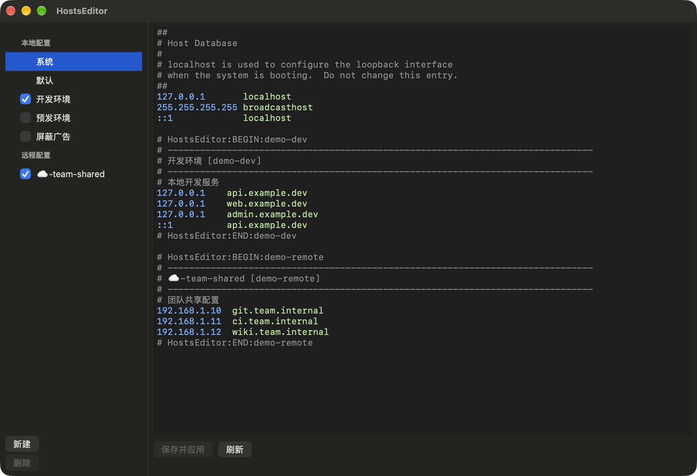

# HostsEditor

一个 macOS 下的 Hosts 文件编辑与方案切换工具，使用 Swift + AppKit 开发，最低支持 macOS 13.0，提供 Apple 芯片（arm64）与 Intel（x86_64）两个独立安装包。

HostsEditor 的核心是在多套 hosts 配置之间稳定切换，并通过特权 Helper 安全写回 `/etc/hosts`。

## 界面预览



左侧是方案列表：「系统」为当前 `/etc/hosts` 全文，「默认」为剥离 HostsEditor 管理块后的基础内容，下方是本地方案与远程方案，勾选即启用；右侧是带语法高亮的编辑器。

## 下载安装

前往 [GitHub Releases](https://github.com/wangwanjie/HostsEditor/releases/latest) 下载与你的 Mac 匹配的 DMG：

| 机型 | 安装包 |
| --- | --- |
| Apple 芯片（M 系列） | `HostsEditor_V_<版本号>_arm64.dmg` |
| Intel 芯片 | `HostsEditor_V_<版本号>_x86_64.dmg` |

不确定机型时，可点击屏幕左上角  → 关于本机，查看“芯片”或“处理器”一栏。安装包均已通过 Apple 公证，自动更新只会推送同架构的版本。

## Star 趋势

[](https://star-history.com/#wangwanjie/HostsEditor&Date)

## 特性

- 多方案管理：创建多套本地 hosts 方案，按需启用、停用、复制或删除
- 系统级应用：将启用中的方案组合后写入系统 `/etc/hosts`，写入后自动刷新 DNS 缓存，立即生效
- 远程方案：从 http / https 地址拉取 hosts 内容保存为方案，支持手动刷新和按间隔自动刷新
- 导入导出：可把本地 hosts 文件导入为方案，也可把当前内容导出为文本文件
- 自动备份：每次写入系统 hosts 前自动备份旧内容（保留最近 30 份），可从「文件」菜单在访达中查看
- 菜单栏快速切换：通过状态栏图标快速启用或关闭方案
- 编辑器：注释、IP（含 IPv6）、主机名语法高亮，查找替换、批量注释（⌘/），支持浅色和深色外观
- 原始内容保留：保留系统 hosts 中不属于 HostsEditor 管理块的内容，写入前会重新读取，不会覆盖其他工具的修改
- 防误操作：有未保存修改时窗口关闭按钮显示提示点，退出前二次确认
- 多语言：简体中文、繁体中文、English
- 自动更新：集成 Sparkle，按架构分别推送更新

## 适用场景

- 本地开发时频繁切换测试环境 / 预发环境 / 线上环境
- 需要保存多套常用 hosts 配置，而不是反复手动注释
- 团队内部通过 URL 分发一份共享 hosts 配置
- 希望从菜单栏快速开关某个 hosts 方案

## 工作方式

HostsEditor 不会粗暴覆盖整个 `/etc/hosts`。

它会把由应用管理的内容写成带标记的块：

```text
# HostsEditor:BEGIN:<profile-id>
...
# HostsEditor:END:<profile-id>
```

这样做有两个目的：

- 可以把多个启用方案组合写入系统 hosts
- 可以保留不属于 HostsEditor 管理的原始基础内容

界面中的几个关键项含义如下：

- `系统`：当前系统 `/etc/hosts` 的完整内容，可直接编辑并保存
- `默认`：从系统 hosts 中剥离掉 HostsEditor 管理块后的基础内容，只读查看
- `本地配置`：你手动维护的方案，可编辑、启用、删除
- `远程配置`：从 URL 拉取的方案，支持刷新

## 首次使用

1. 从 Releases 下载对应架构的 DMG，把 HostsEditor 拖入「应用程序」后打开
2. 首次读取或写入系统 hosts 时，应用会尝试注册特权 Helper
3. 如果系统要求授权，请输入管理员密码
4. 在较新的 macOS 上，如果出现“需要允许后台程序”，前往：
   `系统设置 -> 通用 -> 登录项与扩展程序`
   允许 HostsEditor 的后台程序后重新打开应用

## 权限与安全说明

编辑 `/etc/hosts` 需要管理员权限。HostsEditor 通过一个特权 Helper 完成实际读写：

- 主应用负责界面、方案管理、状态栏和远程拉取
- Helper 通过 `SMAppService` 注册为后台守护进程
- 主应用通过 XPC 与 Helper 通信
- 真正写入 `/etc/hosts` 的动作由 Helper 以高权限执行

这意味着：

- 主应用本身不直接以 root 运行
- 首次安装或重新注册 Helper 时需要系统授权
- 主应用需要关闭 App Sandbox，才能安装并连接 Helper

## 构建与运行

### 环境要求

- 较新版本的 Xcode
- macOS 13.0 及以上
- 可用的代码签名 Team

### 本地运行

1. 打开 `HostsEditor.xcodeproj`
2. 选择 Scheme：`HostsEditor`
3. Destination 选择 `My Mac`
4. 在 `Signing & Capabilities` 中确认：
   - `HostsEditor` 与 `HostsEditorHelper` 的 Team 一致
   - 使用有效签名，或选择 `Sign to Run Locally`
5. 运行应用

说明：

- 项目中的 Helper plist 已使用 `$(DEVELOPMENT_TEAM)`，构建时会自动替换为当前 Team
- 首次真正执行读写系统 hosts 时，系统可能再次弹出权限或后台程序授权提示

## 使用说明

### 新建本地方案

1. 点击左下角 `新建`
2. 选择 `本地方案`
3. 编辑 hosts 内容
4. 点击 `保存并应用`

如果该方案已勾选启用，保存后会立即重新写入系统 hosts。

### 添加远程方案

1. 点击 `新建`
2. 选择 `远程方案`
3. 输入可访问的 URL
4. 应用会拉取内容并创建一个远程方案

远程方案支持手动 `刷新远程`，刷新后如果该方案当前处于启用状态，会自动重新写入系统 hosts。

### 常用快捷键

| 快捷键 | 功能 |
| --- | --- |
| ⌘N / ⇧⌘N | 新建本地方案 / 新建远程方案 |
| ⌘O | 导入 hosts 文件为本地方案 |
| ⌘S | 保存并应用 |
| ⇧⌘S | 导出当前内容 |
| ⌘F / ⌘R | 查找 / 替换 |
| ⌘/ | 注释或取消注释选中行 |
| ⌘+ / ⌘- | 调整编辑器字号 |

### 远程方案自动刷新

在「偏好设置 → 通用 → 远程方案刷新」中可选择不自动刷新、每小时、每 6 小时或每天。远程内容有变化且方案处于启用状态时，会自动重新写入系统 hosts。

### 从菜单栏快速切换

应用启动后会在菜单栏显示图标。点击图标即可：

- 打开主窗口
- 查看所有方案
- 快速切换某个方案的启用状态
- 退出应用

## 常见问题

### 出现 “couldn’t communicate with a helper application”

通常是因为系统里残留了旧版本后台任务记录，或者之前用不同 Team 构建过该应用，导致签名不一致。

先退出 HostsEditor，然后清理旧记录：

```bash
sudo launchctl bootout system/cn.vanjay.HostsEditor.Helper 2>/dev/null || true
sudo launchctl bootout system/cn.vanjay.HostsEditorHelper 2>/dev/null || true
sfltool dumpbtm | rg 'HostsEditor|cn\\.vanjay'
```

然后执行：

1. 在 Xcode 中 `Clean Build Folder`
2. 确认 `/Applications`、`~/Applications` 里没有旧的 `HostsEditor.app`
3. 重新运行当前构建
4. 在应用里点击一次“启用或修复后台帮助程序”
5. 再次触发一次系统 hosts 的读取或写入

### 提示“需要允许后台程序”

前往：

`系统设置 -> 通用 -> 登录项与扩展程序`

允许 HostsEditor 的后台程序后，重新启动应用。

## 打包发布

仓库内提供了 DMG 打包脚本：

```bash
./scripts/build_dmg.sh --no-notarize
```

默认行为：

- 使用 `Release` 配置，分别为 `arm64` 和 `x86_64` 归档，产出两个单架构安装包
- 输出到 `build/dmg/`，文件名格式为 `HostsEditor_V_<版本号>_<arch>.dmg`
- 各架构包的 `SUFeedURL` 分别指向 `appcast-arm64.xml` / `appcast-x86_64.xml`
- 可用 `--arch arm64` 只构建单个架构，`--skip-archive` 复用已有归档重新打包

如果你已经配置好 notarization 的 keychain profile，也可以直接执行：

```bash
./scripts/build_dmg.sh --keychain-profile <your-profile>
```

如需把生成好的 DMG 上传到 GitHub Releases，可执行：

```bash
./scripts/publish_github_release.sh
```

说明：

- 默认上传 `build/dmg/` 下当前版本的两个架构 DMG，也可多次传入 `--dmg` 指定
- 默认优先从 `origin_github` remote 推断 GitHub 仓库，也可通过 `--repo OWNER/REPO` 显式指定
- 默认使用 `v<版本号>` 作为 tag，使用 `HostsEditor v<版本号>` 作为 release 标题
- 如果对应 tag 的 release 已存在，会覆盖上传同名 DMG 资源
- 依赖 `gh` CLI，使用前需要先执行 `gh auth login`

示例：

```bash
./scripts/publish_github_release.sh --generate-notes
./scripts/publish_github_release.sh --repo wangwanjie/HostsEditor --tag v1.0
```

## 项目结构

```text
HostsEditor/
├── HostsEditor/Modules/
│   ├── App/                      # 启动流程、Helper 安装引导、演示数据
│   ├── MainInterface/            # 主界面（方案列表、编辑器、查找替换）
│   ├── MainWindow/ MenuBar/ StatusBar/ Preferences/
│   ├── PrivilegedHelper/         # Helper 注册与 XPC 通信
│   └── Shared/                   # 模型、GRDB 存储、服务（方案管理、备份、自动刷新、更新）、视图、本地化
├── HostsEditorHelper/            # 特权 Helper，读写 /etc/hosts 并刷新 DNS 缓存
├── HostsEditorTests/             # 单元测试（Swift Testing）
├── HostsEditorUITests/           # UI 测试
├── scripts/build_dmg.sh          # 分架构 DMG 打包脚本
├── scripts/generate_appcast.sh   # 生成 Sparkle appcast
└── scripts/publish_github_release.sh # GitHub Releases 上传脚本
```

## 自动更新

项目已接入 Sparkle，并使用以下配置：

- appcast 地址：`https://raw.githubusercontent.com/wangwanjie/HostsEditor/main/appcast-<arch>.xml`（由构建设置 `HOSTSEDITOR_APPCAST_NAME` 决定）
- `appcast.xml` 保留给 1.7.2 及更早的通用版，按 `sparkle:hardwareRequirements` 引导其升级到对应架构的版本
- Sparkle
- GRDB
- SnapKit EdDSA Keychain account：`cn.vanjay.HostsEditor.sparkle`
- `SUPublicEDKey` 已写入 `HostsEditor/Info.plist`

首次在发布机器上配置 Sparkle 私钥：

```bash
<Sparkle bin>/generate_keys --account cn.vanjay.HostsEditor.sparkle
```

`Sparkle bin` 通常位于：

```bash
~/Library/Developer/Xcode/DerivedData/<DerivedData>/SourcePackages/artifacts/sparkle/Sparkle/bin
```

发布 GitHub Release 后，脚本会自动：

1. 上传当前版本的各架构 DMG 到 GitHub Releases
2. 把 DMG 复制到本地 `build/appcast-archives/<arch>/`
3. 重新生成 `appcast-arm64.xml`、`appcast-x86_64.xml`，并重建兼容旧版的 `appcast.xml`

命令：

```bash
./scripts/publish_github_release.sh --repo wangwanjie/HostsEditor
```

脚本执行完后，还需要把更新后的三个 appcast 文件提交并推送到 GitHub 默认分支。

如果要在 appcast 中保留多个历史版本，不要清空本地 `build/appcast-archives/` 目录；脚本会把每次发布过的 DMG 累积到这里，再据此生成多版本更新清单。

## 测试与截图

```bash
xcodebuild test -workspace HostsEditor.xcworkspace -scheme HostsEditor -destination 'platform=macOS'
```

测试运行时应用使用内存数据库，不会读写真实方案数据，也不会弹出 Helper 安装提示。README 截图使用演示数据：以 `--screenshot-demo` 参数启动应用即可，此模式不会读取或修改真实的 `/etc/hosts`。

## 技术栈

- Swift
- AppKit
- Foundation
- Combine
- ServiceManagement
- Security
- XPC
- Sparkle
